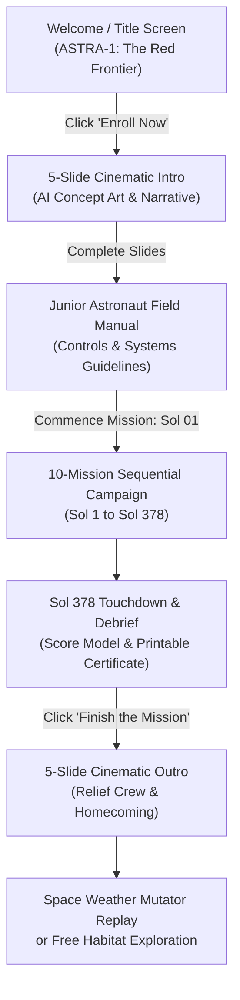

# 🚀 ASTRA-1: The Red Frontier — Final Version Overview
### **2026 NASA Space Apps Challenge Submission**
**Category:** *Build a Junior Astronaut Mission Trainer (JAMT)*  
**Target Audience:** Students (Ages 7–12) & General Public  
**Simulation Duration:** 378 Martian Sols (NASA CHAPEA Mars Dune Alpha Analog)  
**Primary Engine:** Dual-Engine (2.5D Canvas & Three.js 3D WebGL, 100% Vanilla JS, Zero External Runtime Dependencies)

---

## 🌟 Executive Concept & Vision

**ASTRA-1: The Red Frontier** is an authentic, educational space systems engineering simulation. Rather than generic space trivia, players step into the boots of **Cadet Nova**, the junior astronaut aboard humanity's first permanent 378-sol Mars surface habitat in **Arcadia Planitia** (2048).

Modeled after NASA's **CHAPEA (Crew Health and Performance Exploration Analog)** 3D-printed *Mars Dune Alpha* habitat at Johnson Space Center, the game challenges junior astronauts to manage interconnected life-critical systems: balancing electrical power against life support loads, scrubbing carbon dioxide before toxicity sets in, purifying graywater, conducting emergency EVAs during dust storms, deploying the *Perseverance* rover and *Ingenuity* helicopter, and surviving Solar Particle Events (SPE).

---

## 🎬 Complete End-to-End Mission Journey



---

## 🕹️ Core Systems & Gameplay Mechanics

### 1. Title Welcome Screen & "Enroll Now" Portal
* **Welcome Screen**: Introduces the mission context, setting, and systems overview with high-tech NASA Space Apps badges.
* **Enroll Now Action**: One-click launch into the narrative orientation. Players can also bypass directly to the habitat if returning.

### 2. Cinematic Story Cutscenes (10 AI-Generated Art Slides)
* **5 Intro Slides**:
  1. *The Call of the Cosmos*: Sunrise SLS rocket launch from Cape Canaveral.
  2. *The Silent Void*: 7-month interplanetary transit inside the Orion cupola, facing the 14-minute speed-of-light comms delay.
  3. *Fiery Descent*: Retro-rocket landing kicking up red basalt regolith dust in Arcadia Planitia.
  4. *Mars Dune Alpha*: Overview of the 3D-printed curved regolith habitat, solar arrays, and rover.
  5. *Meet the Crew*: Pressure equalized at 101.3 kPa, welcomed by the 4 CHAPEA specialists.
* **5 Outro Slides** (Triggered via `🏆 FINISH THE MISSION`):
  1. *Sol 378 Milestone*: Nova holding the completed holographic mission logbook at Martian sunset.
  2. *Relief Expedition Arrives*: NASA Crew 2 landing under twin supersonic parachutes.
  3. *Astrobiological Treasure*: Loading sealed Jezero Delta core canisters into the ascent craft.
  4. *Farewell, Mars Dune Alpha*: Orbital ascent looking down at the illuminated base.
  5. *Homecoming to the Blue Planet*: Orion approaching Earth, certified as a NASA Commander.

### 3. Living Habitat & Autonomous Room-Restricted Crew
* **4 Dedicated Specialists**:
  * **Cmdr. Sarah Ross** (Mission Commander) — Central Command & Comms.
  * **Dr. Chen** (Flight Surgeon & Astrobiologist) — Science Lab & Medical Bay.
  * **Elena Rostova** (Chief Botanist) — Hydroponic Greenhouse Dome.
  * **Marcus Vance** (Flight Engineer) — Power Grid & Water Reclamation.
* **Autonomous Routines**: Crew members walk between designated workstations inside their rooms, inspect equipment, pause smoothly when the player approaches, and turn to face Cadet Nova during radio transmissions.

### 4. Directional Airlock & Dynamic Spacesuit Protocol
* **Dynamic Suit Switching**: Cadet Nova seamlessly switches between the blue/gray **IVA shirtsleeve uniform** (inside the habitat) and the pressurized **EVA spacesuit with gold visor** (on Mars surface).
* **Directional Safety Interlock**:
  * *Exiting from Habitat*: Players must follow proper safety checklists at the Airlock Console (`🧑‍🚀 1. Put On Suit` -> `✅ 2. Check Seal`). The outer hatch acts as a solid physical wall until unsealed.
  * *Entering from Mars*: Approaching the door from the outside allows immediate one-click entry to save oxygen. Stepping back into the Central Spine automatically equalizes pressure and stows the heavy EVA gear.
* **Multi-Input Hatch Controls**: Operated via `[E]`, `[F]`, on-screen touch buttons, wall switches, or clicking the floating prompt.

### 5. Compounding Real-Time Telemetry Physics
* **⚡ Electrical Power (kW / kWh)**: 100 kW solar array generation dynamic with sun angle and atmospheric dust tau ($\tau$). A 100 kWh battery bank buffers deficits. Finite backup RTG generator burns fuel when activated.
* **🫧 Atmosphere (O₂ & CO₂ ppm)**: Crew respiration generates $\text{CO}_2$. If scrubbers fail or lack power, $\text{CO}_2$ compounds past $1000\text{ ppm}$ (drowsiness) to $2800\text{ ppm}$ (toxicity).
* **💧 Potable Water & Recovery**: Graywater recovery loop purifies hygiene water; filters must maintain electrical conductivity below $15\text{ µS/cm}$.
* **🌱 Closed-Loop Agriculture**: Dwarf wheat hydroponics trays consume water and 5 kW of PAR lighting to produce fresh food, boosting crew morale.
* **🛡️ Radiation & Space Weather**: Regolith shielding attenuates cosmic rays ($0.08\text{ mSv/h}$ baseline). Live NASA DONKI API integration detects real solar flares peaking at $2.45\text{ mSv/h}$.

### 6. 3-Heart Life System (`❤️❤️❤️`) & Emergency Timers
* **Health Buffering**: Cadet Nova has 3 hearts. Hearts are lost if life support or heating is shut down, if critical resources deplete, or if emergency timers expire.
* **Time-Based Emergencies**: High-stakes missions trigger animated 60s–75s ticking countdown bars in the checklist panel.
* **Game Over & Retry**: Reaching 0 hearts displays the Game Over modal with options to retry the mission or restart the campaign.

### 7. Interactive Mission Activities (`js/activities.js`)
* All 30 campaign tasks feature interactive simulation activities (e.g., aligning spectrometer wavelengths, calibrating LiOH chemical flow valves, balancing circuit breaker loads, routing irrigation pumps, patching pipeline seals).

---

## 📜 The 10-Mission Sequential Campaign

| Mission | Sol Range | Title | Core Activity & Scientific Learning |
| :---: | :---: | :--- | :--- |
| **01** | Sol 1–2 | **The First Breath** | Airlock cycling, multi-tool retrieval, initial ECLSS $\text{CO}_2$ scrubber diagnostics. |
| **02** | Sol 24–40 | **First Seeds in Red Soil** | Bioregenerative agriculture, dwarf wheat PAR lighting (5 kW), irrigation pump flushing. |
| **03** | Sol 75–90 | **Commissioning Perseverance & Ingenuity** | First EVA excursion, rover telemetry calibration, drone rotor diagnostics. |
| **04** | Sol 130–145 | **The Rising Sky of Copper** | Emergency 75s timer. Global dust storm ($\tau = 3.8$), non-essential load shedding, RTG fuel activation. |
| **05** | Sol 190–205 | **The Zero-Visibility EVA** | Emergency 75s timer. Gale winds sever external power conduit; EVA repair with replacement fuse. |
| **06** | Sol 250–265 | **ECLSS Scrubber Saturation** | Emergency 75s timer. Amine bed failure, $\text{CO}_2$ spikes to 1800 ppm; LiOH cassette swap. |
| **07** | Sol 295–315 | **The Jezero Delta Core Expedition** | Rover delta core sample extraction, Raman mineral spectrometry analysis. |
| **08** | Sol 330–345 | **The Graywater Biofilm Crisis** | Emergency 75s timer. Catalytic oxidizer biofilm clog; pipe sealant application and conductivity flush. |
| **09** | Sol 360–370 | **Solar Particle Event — Code Red** | Emergency 60s timer. Live NASA DONKI CME alert ($2.45\text{ mSv/h}$); shelter evacuation and shielding check. |
| **10** | Sol 375–378 | **The Return Window — Handover** | Core canister vaulting, fresh crop harvest, final Earth telemetry logbook transmission. |

---

## 🗺️ Habitat Layout (Arcadia Planitia Base)

```text
+---------------------------------------------------------------------------------------------------------+
|                                              MARS SURFACE                                               |
|   [External Solar Array (100 kW)]          [Ingenuity Scout Drone]           [Perseverance Rover]       |
+---------------------------------------------------------------------------------------------------------+
|   [1. AIRLOCK & SUIT BENCH]     |   [2. POWER ROOM]            |   [3. LIFE SUPPORT (ECLSS)]            |
|   - Outer Door ([E]/[F] cycle)  |   - Solar Array Telemetry    |   - Primary & Backup CO2 Scrubbers     |
|   - Suit Bench & Seal Check     |   - High-Voltage Junction    |   - O2 Generator & LiOH Filters        |
+---------------------------------+------------------------------+----------------------------------------+
|   [CENTRAL PRESSURIZED SPINE]   |   [4. WATER RECLAMATION]     |   [5. GREENHOUSE DOME]                 |
|   - Multi-Tools & Spare Fuses   |   - Catalytic Oxidizer       |   - Hydroponic Dwarf Wheat Trays       |
|   - Pipe Sealants & Cassettes   |   - Conductivity Sensors     |   - PAR Grow Lighting (5 kW)           |
+---------------------------------+------------------------------+----------------------------------------+
|   [CREW QUARTERS & BUNK]        |   [6. SCIENCE & COMMS]       |   [7. RADIATION SHELTER]               |
|   - Cmdr. Sarah Ross            |   - High-Gain Earth Uplink   |   - High-Density Regolith Bunker       |
|   - Dr. Chen, Elena, Marcus     |   - 14-Minute Comms Delay    |   - Solar Particle Storm Retreat       |
+---------------------------------+------------------------------+----------------------------------------+
```

---

## 🏆 Scoring & Certification Model

At Sol 378, the simulation evaluates Cadet Nova across four objective pillars:
1. **Campaign Completion (400 pts)**: Finishing all 10 sequential chapters.
2. **Interactive Tasks (300 pts)**: Successfully executing all 30 activities without critical failures.
3. **Resource Stewardship (200 pts)**: Maintaining power, oxygen, water, and food buffers.
4. **Mission Badges (100 pts)**: Collecting all 5 NASA specialist badges.

* **Commander Tier (900–1000 pts)**: Highest honors; unlocks the personalized **Official NASA Junior Astronaut Certificate** with browser print styling (`@media print`).

---

## 🔬 Official NASA Open Data Attribution

* **NASA CHAPEA (Mars Dune Alpha)**: Architectural layout, 3D-printed regolith construction, 4-specialist division, and 378-sol duration.
* **NASA DONKI (Space Weather Database)**: Solar flare events and coronal mass ejection proton flux data.
* **Curiosity RAD & Perseverance MEDA**: Mars surface pressure (0.6 kPa), baseline cosmic radiation (0.08 mSv/h), and atmospheric dust optical depth ($\tau = 0.5 \text{ to } 3.8$).
* **NASA OSDR (Open Science Data Repository)**: Spaceflight dwarf wheat growth metrics, transpiration, and lighting spectrums.
* **Speed-of-Light Radio Delay**: Simulated 14-minute electromagnetic transit time between Earth and Mars.

---

## 💻 Technical Architecture & Delivery Files

```text
JAMT/
├── index.html                   # Primary modular web application
├── astra_1_the_red_frontier.html # 100% self-contained standalone offline bundle (778 KB)
├── build_standalone.js          # Inlines CSS and JS into single standalone file
├── server.js / server.py        # Lightweight local development servers
├── package.json                 # Scripts: start, test, check, bundle
├── vercel.json                  # Production configuration for Vercel deployment
├── assets/story/                # 10 AI-generated 16:9 cinematic story cutscenes
│   ├── intro_1.jpg to intro_5.jpg
│   └── outro_1.jpg to outro_5.jpg
├── js/
│   ├── chapters.js              # 10 sequential mission definitions & objectives
│   ├── activities.js            # 30 interactive minigames & mission procedures
│   ├── simulation.js            # Real-time resource dynamics, hearts & emergency timers
│   ├── game.js                  # Player physics, collision, directional airlock, input
│   ├── render.js                # Custom 2.5D pseudo-isometric Canvas engine
│   ├── render3d.js              # Three.js 3D WebGL habitat renderer
│   ├── ui.js                    # Modals, story sliders, guidelines, HUD, DONKI
│   ├── soundfx.js               # Web Audio API procedural sound synthesizer
│   └── nasa_data.js             # NASA open science telemetry references
└── test/
    └── test_tasks.js            # Headless automated end-to-end audit suite
```
